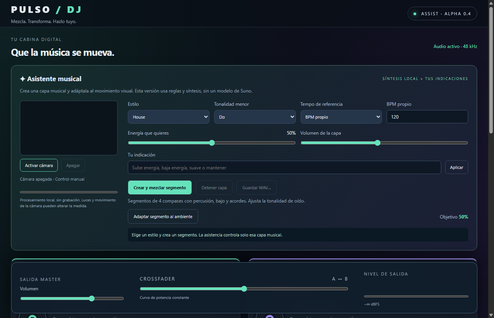

# Pulso DJ

Aplicación de escritorio para mezclar música, controlar una mesa MIDI y crear capas musicales asistidas por indicaciones y actividad visual. El objetivo es un producto para Windows y macOS que aporte funciones a distintas controladoras USB.

**Estado: alpha 0.4.0.** Ejecutable e instalador generados en Windows. macOS está configurado, pero pendiente de compilación y pruebas. No está validado para actuaciones ni sustituye todas las funciones de VirtualDJ. El asistente actual usa síntesis y reglas locales: **no contiene un modelo generativo de Suno ni selecciona canciones automáticamente**.



## Funciones actuales

| Área | Implementado |
| --- | --- |
| Mezcla | Dos decks, reproducción/pausa/búsqueda, volumen, EQ de tres bandas, pitch ±16%, crossfader y master |
| Performance | Cue, cuatro hot cues por deck, loops de 1–16 beats, BPM manual y Tap tempo |
| Efectos | Echo, reverb, filtro paso bajo y drive por deck |
| Hardware | Aprendizaje MIDI de notas y CC absolutos de 7 bits; 46 funciones asignables |
| Importación | Archivos locales y audio público de YouTube; progreso, cancelación y guardado del original |
| Creación | Segmentos de cuatro compases en house, techno o ambient; tonalidad/tempo/energía y exportación WAV |
| Asistencia | Indicaciones reconocidas, movimiento visual local y ajuste gradual de filtro/volumen de la capa creada |
| Interfaz | Platos animados, forma de onda, región del loop, medidores y espectro reactivo |

USB no garantiza compatibilidad: la mesa debe exponer MIDI. Falta conocer y probar el modelo de controladora del usuario.

## Instalar

Descarga el instalador Windows de la [última versión](https://github.com/lnavarrocarter/pulso-dj/releases). Incluye el importador de YouTube y no requiere instalar Node.js, Python o FFmpeg para usar la aplicación. El instalador alpha no está firmado y puede producir un aviso de Windows. No hay aún instalador de macOS publicado.

## Desarrollar

Requisitos: Node.js 24 LTS con npm y Git. En Windows o macOS:

```sh
git clone git@github.com:lnavarrocarter/pulso-dj.git
cd pulso-dj
npm ci
npm start
```

`npm start` prepara yt-dlp desde su publicación oficial si falta, verificando su SHA-256. Esa preparación necesita Internet. La síntesis, cámara y reproducción local no necesitan servidor ni cuenta. YouTube sí necesita red.

## Verificar y empaquetar

```sh
npm test
npm run test:desktop
npm run test:assistant
npm run pack
npm run dist -- --publish never
```

- `npm test`: 16 pruebas de lógica, síntesis, permisos e importador con procesos simulados.
- `test:desktop`: transporte, loops, hot cues y FX en Electron, con audio silenciado.
- `test:assistant`: generación/reproducción de la capa, control manual y cámara sintética de Chromium. No abre una cámara real.
- `npm run test:youtube`: prueba opcional de red que descarga temporalmente Big Buck Bunny y comprueba decodificación; puede fallar por disponibilidad o restricciones de YouTube.
- Los instaladores salen en `release/`. Compila cada plataforma en su sistema; valida la cámara y controladora reales por separado.

## Documentación

- [Roadmap y criterios de aceptación](docs/ROADMAP.md): fases priorizadas, lo que falta y decisiones abiertas.
- [Guía de uso y límites](docs/USER_GUIDE.md): loops, efectos, importación, cámara, segmentos y compilación.
- [Arquitectura](docs/ARCHITECTURE.md): módulos, grafo de audio, permisos y camino hacia IA real.
- [Validación y distribución](docs/VALIDATION.md): qué se ha probado y qué sigue sin comprobar.
- [Historial](CHANGELOG.md): evolución de 0.1 a 0.4.

## Límites principales

Salida estéreo del sistema, sin preescucha independiente, selección de tarjeta ni ASIO. No hay detección automática de BPM/tonalidad, beatgrid, sync, key lock, scratch, biblioteca persistente ni grabación del master. El audio se decodifica completo en memoria; pistas de hasta 20 minutos y 128 MB. Los cues no persisten entre sesiones.

La cámara mide cambios de imagen, no emociones, preferencias ni número de personas. Se activa mediante un botón y no graba ni envía vídeo. Las indicaciones manuales dominan sobre la actividad visual. La asistencia ajusta únicamente la capa generada; el DJ mantiene el control de los decks.

## Distribución y licencias

El repositorio se mantiene privado mientras se decide la licencia del código propio y el modelo de distribución. No se ha otorgado una licencia de código abierto. Electron, yt-dlp y sus dependencias conservan sus licencias; los avisos de yt-dlp se incluyen en `assets/tools/` y en los instaladores. Usa música propia o autorizada.

Git contiene el código, el lockfile, pruebas, documentación, captura y metadatos/avisos de herramientas. `node_modules/`, temporales, claves, ejecutables descargados y paquetes generados se excluyen. Los instaladores se adjuntan a versiones de GitHub.
